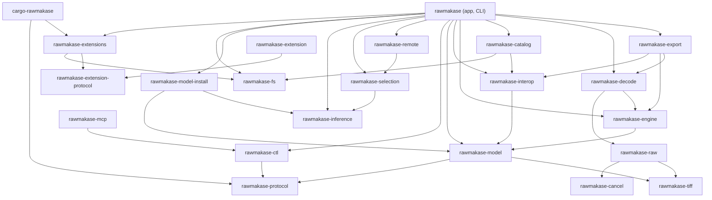

# Architecture

Status: Current. How RAWmakase is divided, which way dependencies point, how work
moves between threads, and the rules and contracts every change keeps. For
file-by-file navigation, runtime flows, storage locations and feature entry points,
see the [code map](code-map.md); for the words used here, the
[glossary](glossary.md). Feature details live in each module's `//!` docs.

## Crates and dependency direction

RAWmakase is a Cargo workspace. The app crate (`src/`) is the desktop editor and
the command line; everything it composes is a crate below it, and dependencies
point only down:

(Edges implied by others are left out: every crate above the model also depends
on it directly. The app doesn't link `rawmakase-mcp`: `rawmakase mcp` runs its
program, installed beside the app, and `scripts/crate-closures.sh` keeps it
out of the app's tree.)

| Crate | Owns | Builds without |
| --- | --- | --- |
| `rawmakase-model` | What an edit is, as values: the recipe and its settings, camera and lens profiles, colour primitives, DNG hints, output buffers, file identity and storage helpers | The RAW decoders, the renderer, wgpu, the GUI |
| `rawmakase-interop` | The file formats and presets over the model: XMP, Lightroom's Develop settings, presets, raw defaults, EXIF and JPEG, export settings, and which edit a photo develops with (`edits`) | The same |
| `rawmakase-catalog` | The SQLite catalog, Lightroom catalog import, file operations, and the stored edit records `edits` resolves | The same |
| `rawmakase-engine` | The renderer (`develop`): the CPU pipeline, which is the reference, and the GPU preview port | The RAW decoders, the catalog, the GUI |
| `rawmakase-raw` | RAWmakase's own RAW decoders ([RAW decoding](raw-decoding.md)) | Everything but `rawmakase-tiff` and `rawmakase-cancel` |
| `rawmakase-tiff` | The bounded TIFF reader DNGs and RAW containers use; no RAW knowledge | Everything |
| `rawmakase-fs` | What moving a user's file needs of the file system, policy-free: exclusive renames, file ids, exact listings, name comparison, containment, volume facts and a copy's steps, one file per system, with the unsafe system calls the model used to hold. The catalog's file operations and the app's Trash use it | Every other workspace crate; the value, file-format, rendering, decoding and export crates never reach it |
| `rawmakase-cancel` | `Cancel`, the borrowed request to stop long-running work, which its owner's flag sets: every crate that does such work takes one, and owners keep their flags | Everything |
| `rawmakase-decode` | Opening and decoding photos: the only crate that reaches `rawmakase-raw`; colour management, demosaicing, rendered files (JPEG … HEIF), the full-size decode and its cache, AI Denoise's packing and assembly, Camera Look fitting | C imaging libraries, the catalog, export, the GUI |
| `rawmakase-export` | Developing and writing exports, with their watermarks | The app, a window or GPU backend |
| `rawmakase-inference` | The lazily loaded ONNX Runtime, the provider choice and the session helpers every model shares, `InferenceError`, the `ModelFile` record, and AI Denoise's model: its contract, tiler and gain fit, packed mosaic in, denoised camera RGB out | Every other workspace crate |
| `rawmakase-selection` | The selection models (Subject, Background and Sky): their pinned contracts, the image and coverage mappings, automatic selection, edge refinement and their sessions, run through inference's runtime: pixels in, coverage out | Everything but inference |
| `rawmakase-model-install` | Installing a model pack: a folder and its files, downloaded resumably or copied from a folder, each checked against its size and SHA-256, the receipt that makes a pack installed, the lock across instances, and the models and runtime folders in the local data folder. Which packs exist is its caller's | Everything but inference and the model |
| `rawmakase-remote` | The optional worker binary that runs the same selection models on another computer, and the app's client for it, over a bounded TCP protocol | Everything but the selection models and inference |
| `rawmakase-protocol` | What the app and its control clients agree on: protocol version, `control.json` endpoint, data folder | Everything |
| `rawmakase-ctl` (`tools/`) | The control client, used by `rawmakase control`, the MCP program and the standalone `rawmakase-ctl` | The app |
| `rawmakase-mcp` (`extensions/mcp`) | The bundled MCP extension: its manifest and its program `rawmakase-mcp`, an MCP server that is a client of the control protocol, which `rawmakase mcp` runs | Every workspace crate but `rawmakase-protocol` and `rawmakase-ctl` |
| `rawmakase-extension-protocol` | What the app and extensions agree on ([extensions](extensions/overview.md)): the manifest and its schema, the protocol's messages, error codes and bounded line framing, host-drawn controls | Every other workspace crate |
| `rawmakase-extension` | The SDK extension programs are written with: the channel, the run loop, handler traits, receiving and mapping the buffers the app passes (`shm`), a mock host for tests that passes them as the app does | Everything but the extension protocol |
| `rawmakase-extensions` | The extension host: manifests, `.rmext` packages, installation from a file or GitHub, `extensions.json`, bundled discovery, starting programs in a process group or job object, sessions with deadlines and bounded queues, request buffers in shared memory with their leases and handle passing (`shm`), and running an externally launched adapter's program in place of its launcher (`external`) | Any photo, edit, catalog, renderer, decoder or GUI crate |
| `cargo-rawmakase` (`tools/`) | The extension author's tool: `new`, `build`, `package`, `release`, `dev` | The same |

The extension crates know no photo, edit or catalog: what an extension's
requests mean to the editor (applying a proposal, a device's operation) is the
app's, so the host can be shared by the app, `rawmakase extensions` and
`cargo rawmakase`, and an extension builds without anything of the app's.
`scripts/deps-crates.txt` and `scripts/crate-closures.sh` hold them to that.
`extensions/example` (`rawmakase-example`) is a test-only extension built with
the SDK alone, as a third party would build one; the app's tests run it and it
is never bundled.

Inside the app, `app::extensions` owns extensions at run time: which are
loaded (bundled, installed, developer folders), when each program runs (a
`with-app` one after the first frame, an `on-demand` one at its first request,
stopped after 5 minutes idle), its crashes (three in a row make it Failed until
Retry, for this session), its commands, settings and panels, and what its
requests mean to the editor. It is the only caller of the host's sessions in
the app: `Editor::new` starts it and a test editor's stays inert. A program's
reads and proposals are answered through the editor on the UI thread, one
poll per frame; what opens photos' files (a read or a proposal of photos not
open in Develop, a command's target among them) runs on a worker and is
answered when it finishes. A read of a photo not open gives the settings
Develop would open it with (`library::sync::starting_recipe`: its saved edit,
else its Lightroom edit or the raw defaults). A proposal belongs to one of the
app's `command.run` requests
and is admitted only while that request is in flight, checked immediately
before it is applied. Its target token names the catalog's location and
structural generation and, per photo, the file's identity and the catalog's
fingerprint (`Catalog::photo_fingerprint`); the open photo is checked against
Develop's live state and, alone in the proposal, changed through its edit path
as one History step. Photos not open are changed on a worker, as the running
batch, through the batch edit's path (`library::sync::apply_proposal`) and one
`Catalog::change_edits_if`, which compares each fingerprint and asks whether
the proposal is still admitted inside the write transaction; the program is
answered when the worker finishes, and a proposal with the open photo among
others saves it first and sends it to the worker too, so it is one Undo. The
catalog owns the fingerprint and the conditional write; the app owns what a
token holds. Every persisted change goes through the host
crate's `State::update`, so a write failure leaves this session's state as it
was. Quitting follows [the shutdown contract](shutdown.md).

An extension's mask generator (`app::extensions::mask_generator`) runs
through the same request state machine as Select Subject
(`develop::tools::subject_mask`), which owns the busy state, the guards (load,
task generation, the masks' structure and content) and the one History step;
the extension side owns the tiles, the provenance lookup and the requests.
Neither direction does pixel work on the UI thread: the selection worker
renders the input into the request's shared memory before it is sent, and
copies the coverage out and registers the raster after the reply, and only
then does the UI thread apply it. A request captures its extension's
lifecycle count (`Host::mask_lifecycle`, moved on whenever the host ends the
extension's program: disabled, uninstalled, loaded again, crashed, hung), and
is void in any phase once it has moved: busy clears at once, the worker's job
is cancelled, and nothing it produces applies. A mask result is not a proposal and has no
target token; edits made while it runs that change neither the masks'
structure nor the content (sliders, names) survive it. Extensions' generators
are not aimed with clicks yet; their tiles are those of generators that take
`none`.

No value, catalog or rendering crate can reach `rawmakase-inference` or
`rawmakase-selection`, so saved masks render without any inference installed and a photo with AI Denoise renders from a
result handed to it. The app crate re-exports these crates' modules at its root
(`crate::model`, `crate::xmp`, `crate::catalog`, `crate::develop`…), so paths read
the same on either side; parsing, persistence and rendering never import the
desktop UI. Inside the app crate, `scripts/deps.py` checks the same direction
between top-level modules (see [boundaries](#boundaries-to-preserve)).

## Module ownership

| Module | Owns | Main extension points |
| --- | --- | --- |
| `camera_data` | A RAW's metadata, the demosaic and decode choices and the decoded camera-space image, as values with no native code | `camera_data.rs` |
| `raw` | RAW files: reading metadata, decoding into `camera_data` images, oriented embedded thumbnails, with RAWmakase's own decoders (`crates/rawmakase-raw`, see [RAW decoding](raw-decoding.md)) | RAW decoding |
| `color_management` | The profile each export colour space embeds (`output_profile`: sRGB's, and the CC0 Adobe RGB and ProPhoto profiles) and the transform of 8-bit sRGB to a monitor profile, in pure Rust (moxcms reads the profiles) | `color_management.rs` |
| `photo` | Opening a photo: `open_source` is the one entry point, sending a RAW to `raw` and a JPEG, PNG, TIFF, WebP, AVIF, HEIF or JPEG XL to `raster`; a RAW's decoder facts from `raw`, then the camera's lens tables, a DNG's profile and hints, and the imported lens profiles that fit | `photo.rs` |
| `raster` | Opening a JPEG, PNG, TIFF, WebP, AVIF, HEIF or JPEG XL: decoded upright and converted from its embedded ICC profile or CICP colour to 8-bit sRGB for previews, or to linear ProPhoto f32 for Develop (pure Rust: `image`, `jxl-oxide`, `rav1d` without assembly, `moxcms`; a HEIC's pixels come from the system's ImageIO on macOS, Windows Imaging Component on Windows, and elsewhere the system's libheif, opened at run time; without it a HEIC is listed and decoding says what to install) | `raster.rs`, `raster/` |
| `demosaic` | RAWmakase's own Bayer and X-Trans demosaicing of the unpacked sensor data | `demosaic.rs` |
| `dng`, `tiff` | A DNG's rendering hints (embedded profile, baseline exposure, crop, opcodes) and the bounded TIFF reader behind them (`crates/rawmakase-tiff`, a leaf crate with no RAW knowledge, re-exported as `model::tiff`) | `dng.rs`, `rawmakase-tiff/src/lib.rs` |
| `decode` | A photo's full-size image, made one way for Develop, prefetch, Reference View and export: the cache's copy, else a decode with highlights recovered and stored, as a `DecodePolicy` asks | `decode.rs` |
| `decode_cache` | Disk cache of developed camera images, keyed by file identity, demosaic setting and build; the app shares one live size limit and folder across Develop, prefetch, Reference View, export and preview builds, persisted in its session | `decode_cache.rs` |
| `rawmakase_decode::ai::denoise` | AI Denoise's side of decoding, with no model knowledge: the visible mosaic packed as the model takes it (`PackedBayer`, RGGB; X-Trans rebuilt as RGGB by `Raw::packed_bayer`), the camera image assembled from the model's output (`assemble`), and `AiBase`, the trait export and the app ask for a photo's complete AI source through (`AiService`; `Refusing` for callers without one) | decode's `ai/denoise.rs` |
| `ai_cache` | Disk cache of AI Denoise results: its own subfolder, extension and size cap (10 GB by default) over the decode cache's trim, purge and relocation (`decode_cache::Namespace`); half-precision payload with the gain applied, checked finite when stored and loaded | decode's `ai/cache.rs` |
| `camera_profiles` | DCP parsing and validation, camera transforms, RAWmakase's own profiles, profile library and camera matching, the community profile catalogue (`data/camera-profiles`: parsing, validation, matching, byte and identity verification, and its generator), `.cube` LUTs imported as look profiles, fitted camera looks as profiles (built only; fitting is `camera_look`'s), DNG temperature/tint | `dcp.rs`, `library.rs`, `catalogue.rs`, `open.rs`, `cube_look.rs`, `fitted.rs`, `reference.rs` |
| `camera_look` | Fitting Camera Look (fitted) to a RAW's embedded JPEG: preview choice, pairing with the photo's render, solvers and acceptance on held-out tiles, and the default fit of photos without colour data through its fit cache. In `rawmakase-decode`, as it opens RAWs and decodes their previews; the model only builds and checks what it finds, and the catalog, `xmp` and presets never fit (the app and export pass the default in with the photo's profiles) | `camera_look/` |
| `optics` | The lens correction model the renderer evaluates (vignetting, distortion and lateral CA as radial functions), Adobe lens profiles (LCP) as data, and Lensfun calibrations as data with their evaluation for a photo; depends only on `xml` | `mod.rs`, `lcp.rs`, `lensfun.rs` |
| `lens` | Readers that fill the `optics` model: imported Adobe LCPs, Lensfun's database (read, matched, installed) and lateral CA measurement, plus profile selection; an edit's Lensfun lens carries its own copy of the calibration, so rendering never reads the database. The tables cameras embed in their RAWs are read next to the RAW containers, by the decode crate's `raw::lens` | `lcp.rs`, `lensfun/`, `auto_ca.rs`, `choice.rs` |
| `rendered` | Developed pixels as values: an output image, its histogram and clipping overlay, which the renderer produces and export and watermarks use; depends on nothing | `rendered.rs` |
| `model` | What an edit is, as values shared by the renderer, the catalog and file formats: the `Recipe` with its validation (`ValidRecipe`), saved versions and migration, panel switches, and the settings it is made of: Effects, Heal and Clone, Red Eye, Point Color, masks, Transform with Upright, white balance from metadata, the image space positions are kept in (`image_frame.rs`), the sliders as parameters, the rules an edit follows, the setting groups Copy Settings, Sync and presets use, and Camera Raw's keys for the sliders (`camera_raw.rs`). Depends on camera profiles, lenses and optics, never on rendering | `recipe.rs`, `valid.rs`, `saved_format.rs`, `panels.rs`, `operators.rs`, `effects.rs`, `masks.rs`, `transform.rs` |
| `develop` | Rendering a recipe: geometry, color processing, the scene tone stage, curves, effects, local adjustments, detail rendering and the GPU port | `pipeline/`, `scene_tone/`, `quality/`, `geometry.rs`, `gpu/` |
| `xmp` | Namespace-aware Adobe settings parsing and application to recipes. Settings that ask for Auto measure the photo through the model's `PhotoMeasures` (`model::measures`), which `develop::Measures` provides, and packets take the crop as rendered from the caller, so XMP needs no rendering code | `parse.rs`, `apply.rs` |
| `raw_defaults` | Lightroom's Raw Defaults: the master and per-camera choices and a photo's starting settings. Above `presets`, whose library it reads | `raw_defaults.rs` |
| `presets` | Native JSON recipe presets, installed XMP collections, favorites and preset import, and a preset's application to one photo, which Develop and the Library's batch share | `native.rs`, `library.rs`, `photo.rs` |
| `storage` | RAW identity checks, which files are photos and the rendered formats' facts (`RasterFormat`: extensions, MIME types, names; the codecs are `raster`'s and `export`'s), application paths and atomic JSON writes. The file system primitives moving a user's files needs are `rawmakase-fs`'s. Saved-recipe versions are `model::saved_format`, the desktop session is `app::preferences::session` and legacy sidecar import is `catalog::legacy_sidecar` | `identity.rs`, `files.rs`, `formats.rs` |
| `export_settings` | Export choices as values: the Export dialog's settings, Rename Photos' remembered choices (`RenameSettings`), the user's saved file-name templates (`SavedTemplates`), a photo's saved `ExportOptions`, and the naming templates (`NameTemplate`: Lightroom's presets and Filename Template Editor templates, `TokenTemplate`) exports and renames name files by, from the `NameFields` taken once per export | `export_settings.rs`, `export_settings/tokens.rs`, `export_settings/rename.rs`, `export_settings/saved.rs` |
| `export` | JPEG, 16-bit TIFF and PNG encoding, selected EXIF with the colour space's ColorSpace and interoperability index, ICC embedding of the pixels' colour space (taken from the `ExportImage`, never from a second setting), the sRGB conversion of watermark colours, atomic output publication | `mod.rs`, `metadata.rs` |
| `ids` | Typed catalog row ids (`PhotoId`, `FolderId`, `RootId`, `CollectionId`), stored and serialized as their integers; a leaf, so edit resolution and export use them below the catalog | `ids.rs` |
| `metadata` | Photo metadata as values: descriptive fields (title, caption, copyright, creator, capture, location), keywords and camera settings; depends on nothing else | `metadata.rs` |
| `edit_session` | The edit of the photo open in Develop apart from the window: its bounded History (named steps, one per gesture, saved with the edit) and save state; no egui | `history.rs`, `save_state.rs` |
| `edits` | Which edit a photo develops with (saved, Lightroom or raw defaults), shared by Develop, Library previews, Sync and Export: `resolve` at once, or a `Start` chosen once and resolved later; callers keep their own error and warning policies. The catalog only reads the stored records. In `rawmakase-interop`, so export resolves edits without the catalog | `edits.rs` |
| `catalog` | RAWmakase SQLite database, schema, photo/folder/collection models, edits, relinking, the default Creator and Copyright of photos added from folders (below the camera's own, which the app's reader finds, as the catalog can't reach the RAW decoders), Synchronize Folder's and Find on Disk's engine (`folder_sync`: scan, matching, apply, family digest; named apart from `app/library/sync.rs`, which is Sync Settings) and disposable preview cache | `schema.sql`, `models.rs`, `mod.rs`, `folder_sync.rs`, `preview_cache.rs` |
| `catalog::db` | The catalog's one connection boundary: an opaque `Db` with checked reads, `snapshot` for consistent reads, `write` as the only way to write, and `with_lightroom` for import; statements are `Sql` (portable) or `SqliteSql` (Lightroom), shape-checked at compile time; values go through the catalog's own `ToValue`/`FromRow` (`catalog::value`) | `mod.rs`, `sql.rs` |
| `catalog::lightroom` | Read-only Lightroom snapshot import | `mod.rs`, `history.rs` |
| `catalog::file_ops` | The one owner of changing where a photo or folder is or what it is named, on disk and in the catalog (#370, #556): planning against a snapshot, the refusals, destination conflicts, names, which companion files go with a photo (by `catalog::sidecar`'s candidate rule), the journal, the operation lock, execution and recovery. Names photos from `interop::export_settings::NameTemplate`, the one owner of naming templates. Reaches the file system through its `Disk` seam over `rawmakase-fs`, the Trash through a `Trash` the app passes in | `plan.rs`, `execute.rs`, `recover.rs`, `journal.rs`, `rename.rs`, `tree.rs` |
| `catalog_session` | The open catalog and the lists read from it, with no window: opening it, reading it again, writes that must keep those lists in step (ratings, descriptive metadata, collections, virtual copies and their names, stacks), behind private fields: the lists and catalog are read through accessors, and the writes that change no list (edits, History, snapshots, camera sequences) are methods of their own, the background reads that fill in capture times and photo info for photos added from folders, and the throttled checksum reader, whose results a structural generation guards. Above `photo` and `raw`, as reading a RAW's info opens it; `app::library` decides which photos are online and shows the lists | `mod.rs`, `backfill.rs`, `background.rs`, `checksums.rs`, `stacks.rs` |
| `lr_develop` | Best-effort conversion of Lightroom's serialized Develop settings into a recipe, through XMP; below the catalog, so edit resolution can use it | `lr_develop.rs` |
| `app` | Desktop editor state, UI, dialogs, background task coordination and presentation | Components described below |
| `platform` | OS integration: the Linux GVFS filesystem bridge, drives, the file manager, the browser, the system Trash file operations get (`trash::SystemTrash`, failing closed, and whether a drive has one; no policy), and the display's color management (macOS surface tagging and EDR, the Windows display profile), and whether a RAW on a network volume is read for its embedded preview alone (`preview_reads`) | `network.rs`, `volume.rs`, `reveal.rs`, `web.rs`, `trash.rs`, `display.rs`, `preview_reads.rs` |
| `diagnostics` | The system report a bug report asks for (Report an Issue…, `rawmakase system-info`): this build, the system probed once per process and what the window knew, as plain snapshots, with no path, user, file, catalog or profile name | `diagnostics.rs` |
| `updates` | Release checks and self-update through fastframe-update; the notice itself is in `app` | `updates.rs` |
| `ai_denoise` | AI Denoise's service, shared by the desktop app and the command line: the queue, the worker and its ONNX session, job keys, the finished-result lookup, `AiBase` for export; `CommandLine` for `render` and `render-batch`, and the `rawmakase denoise` development command. No egui and no `app`: the open photo's result and the Loupe's loader are `app::develop::ai_denoise`'s, and the app passes the user's cache in | `mod.rs`, `command_line.rs`, `bench.rs` |
| `model_install` | The app's model packs (Select Subject's, Sky's, AI Denoise's): which files each holds and its folder; installing them is `rawmakase-model-install`'s, and the threads and the drawer are `app`'s | `mod.rs` |
| `lensfun_install` | Downloading, checking, publishing and removing Lensfun's lens database on request (never bundled, never fetched unasked); reading it is `lens::lensfun::installed`'s, the panels and the job thread are `app`'s | `lensfun_install.rs` |
| `comparison` | Reproducible reference-image comparisons using the same develop APIs | `comparison.rs` |

`color` holds shared numeric primitives (matrices, sRGB transfer, HSV), the export colour
spaces (`color::output::OutputSpace`: each space's matrix from linear sRGB, transfer curve
and luminance, the one owner of those facts for the engine, export settings and export)
and the tone-curve model (`color::curve`). It depends on nothing else, so camera profiles, XMP and the
interface use it without depending on recipe or render orchestration. Presets and
camera profiles independently use storage's asset-directory policy; neither
library discovers its folders through the other.

## Threads and jobs

The UI thread owns the `Editor` and draws every frame. Long work (decoding,
rendering, opening or importing a catalog, file operations, autosave) runs on
worker threads, which report back, mostly through named `worker::Event`s and
otherwise through a channel of the service's own (autosave, the catalog session's
background readers), and ask for a repaint; the UI thread applies a result only if
it is still wanted. Some short catalog work stays on the UI thread on purpose: the
synchronous save before navigating to another photo (`Editor::flush`, after
waiting for the autosave in flight) and the catalog session writing what its
background readers found (`catalog_session::backfill`). Closing and quitting save
the Develop edit on the autosave thread instead and wait only until a deadline
(`Editor::flush_by`), so a stalled catalog cannot hold up closing on it. Two writes
before it still run on the UI thread without a deadline: a Library Copy Name or
metadata field being typed, and the session file ([shutdown](shutdown.md#where-the-code-stands)). One table, `app::work`, says for each kind of work whether closing waits for it, whether the status line lists it (and where its progress shows otherwise), whether it slows the Library's edited previews or pauses the checksum reader, and its step of the exit sequence; the close guard, the status line, preview pacing and quitting read it, each from the state that owns the work. Four kinds of worker exist:

- **One-off tasks** (`app::task::spawn`): opening a catalog, an import, a file
  operation, a fit, and Develop's analyses of the open photo (Auto, Upright, Auto
  Straighten, the targeted adjustment and Point Color samples). A panic still
  reaches the UI as a failure. The state that owns
  the work says it is running. Fits and downloads are owned by a `Task`, whose
  generation and cancel flag reject stale results. Catalog dialogs, opening and
  import, folder changes, batch edits and file operations hold
  `app::activity::Activity`, which allows one foreground operation at a time and
  keeps the busy state; how each of those checks that its result still applies is
  its own (a catalog location, the catalog session's structural generation).
- **Latest-only workers** (`app::worker::Latest`): the Develop loader, its full-size
  stage and prefetch, the renderer (with lanes for the edit and Before), Reference
  View, stand-ins, the Loupe and its zoom. A single-slot mailbox replaces pending
  work with the newest request; a panicking job does not end the thread.
- **Owned services with their own queue**: autosave (its own thread and catalog
  connection), AI Denoise (`ai_denoise::Service`: one queue and one worker for
  Develop, export and the CLI), the Library's edited-preview scheduler and thumbnail
  workers, and the catalog session's background reads (capture times, photo info,
  checksums).
- **Rayon pools** inside a job, for pixel work; background work such as the
  neighbour's prefetch uses a small pool at background priority
  (`raw::background_pool`).

Every worker, what it blocks on, how it stops and whether quitting waits for it is
in the [shutdown contract](shutdown.md); a change that adds a worker or changes
what one waits on updates it.

The rules every job must follow (known gaps are tracked in #808):

- **Inputs are captured once**, when the job is made, and the same values give its
  cache identity. A job never reads editor state while it runs.
- **Results are checked against the current state.** A generation (the task's, the
  load's or the catalog session's structural one) rejects cancelled, superseded and
  duplicate completions, and a file's `Identity` rejects a result for a file replaced
  meanwhile.
- **Every ending clears busy state**: success, failure, panic, cancellation and a
  worker that disconnects.
- **No unbounded waits.** Quitting signals every worker, then waits with a
  deadline (`task::wait_for`); nothing joins in `Drop`.

Each load/render task owns its generation, cancellation token and lifecycle.
The single-slot mailbox replaces pending work. The app discards obsolete results,
and a failure only finishes its owning task. Worker messages use named fields;
render stages are enums, independent of user-facing status text. Exports capture
their recipe before starting, and overwrite confirmation holds the current photo.
Choosing what to export commits Library typing and reads every chosen photo's
name fields from the catalog in one snapshot; what only the files have (the
camera's make and model, and a photo without a catalog's capture time and info)
is read by one background read per scope, started only when the file-name
template needs it. The dialog's Example and the planned names both come from
these fields; a read of a replaced or cancelled scope is dropped, and Export
waits for, or says it goes on without, what its names need.

Document reset clears its edit history and decoded images together; a catalog
photo's History then comes back from the catalog with its edit. A frame's
history transaction is bound to the load generation, so navigation during drawing
cannot record the previous photo's edits against the new photo. A control names
the History step it makes in the editor's `StepName`, passed to it explicitly
with the recipe; the frame hands the last name given to History as it finishes,
after ending a wheel scroll or control-surface turn still going as steps of
their own. Preset-browser
preferences survive navigation; hover previews and compatibility results do not.
Session preference writes have an explicit destination; UI tests disable them or
inject a temporary file, without changing the process-wide environment.

Folder-drop workers resolve the imported folder tree keys against actual local
locations (including mapped symlinks). The source keys travel with the reopened
Library result; the UI applies them after restoring layout and filters, so the
result's source cannot be replaced by the old view. Filesystem resolution stays
on the worker.

### Previews

How preview renders are scheduled; what runs on the GPU, its backends, budgets and
textures are described in [`develop::gpu`](../crates/rawmakase-engine/src/develop/gpu/mod.rs)'s
module docs.

There is no separate draft pipeline. Fit renders the current pipeline from the
smallest pyramid level at or above the physical viewport size on every change. While
an edit is slower to present than 40 ms, a reduced render from the pyramid is
published first as a draft stage: at 100% the region at half resolution or less, and
for the whole photo at an edge halved until it has at most a megapixel. The
single-slot mailbox keeps only the latest pending job. An edit of the same document
and view (`Editor::schedule_edit`, `Task::supersede`) lets the running render finish,
and its frame shows with the settings it was asked for, so a GPU slower than the
slider still shows frames during a drag; any other render, and the next view or
photo, cancels the running ones, and a result older than the one shown is dropped.

`develop::PreviewRenderer` owns the optional GPU processor and fallback state.
The desktop renderer creates it on its worker thread. Headless UI tests and the
legacy `worker::renderer` entry point remain CPU-only. Domain color processing,
RAW development and exports use the existing CPU implementation, which is the
reference: the GPU port covers recipes resolved with a camera profile, and
everything else renders on the CPU. Any GPU failure falls back to the CPU and turns
the failing path off for the session. GPU work already submitted cannot be
interrupted, so obsolete results are discarded before they are published;
full-quality CPU stages check cancellation within pixel, row and column work.

### AI Denoise

AI Denoise ([rendering quality](rendering-quality.md#ai-denoise)) has one service, `ai_denoise::Service` (a root module, so the command line uses it without the app): one
queue and one worker thread for Develop, export and the CLI (one service per
command, so `render-batch` loads the model once, with the user's cache in the folder
Preferences chose, as the app keeps it). A job's
inputs are captured once as its key (the file's identity, the model's SHA-256, the
adapter version, the provider and the build), which also names its cache entry; a
request for a key already queued or running waits for that job. Develop's requests
run the tiles covering the 100% view first and publish one partial source after
them, then the final one; each publication is a new `AiSource`, so the retouch
cache, the pyramid and the GPU upload see a new source. A non-finite tile on the GPU
discards the attempt, which reruns on the CPU under the CPU's key with every job
queued behind it, and the GPU is not used again in the session. A request carries the
file's identity when its plain image was decoded (`AiBase::get` takes it too), and
Develop's request is keyed by it without reading the file on the UI thread; the
worker reads the file before and after the job, and a request joined to a job of
the same file under another path (a hard link) is checked against its own file as
each result is handed to it: a file changed since, before or during the job, cached
result or not, gets no result, so a photo is never denoised from another file. A result is rejected when the model
changed during the job, and an update for a plain image that is no longer the open
photo's is dropped. A panic in a job's run fails that job; one while handing a result
to a listener fails that listener alone; and if the worker thread dies anyway, the job
it held and every queued one fail, so no Develop request or export waits for it, and
the next request starts a new worker. The Detail panel's switch and Amount are ordinary edits (one
History step each); a result arriving is not one. `app::develop::panels::inspector::ai_denoise` draws
the panel's controls, credit and install offer; the model installs as
`model_install::Pack::Denoise`, as the selection models do.

## Data flow

The [code map](code-map.md#how-an-operation-moves-through-the-app) follows each
operation step by step; in terms of the crates:

- **Opening a photo.** The Library (`app::library`) decides whether Develop may
  open it (below). Its starting edit is resolved from the catalog's record (`edits::resolve`:
  saved edit, Lightroom edit or raw defaults); the loader opens it through
  `rawmakase-decode` (`photo::open_source`, then the embedded preview, the half-size
  and the full-size decode through the decode cache) and the renderer develops it
  with `rawmakase-engine`.
- **Editing.** A panel changes the recipe inside the editor's frame
  (`edit_session`): the frame records one History step and marks the edit for
  saving. The renderer gets the captured recipe and view; autosave writes the edit
  through `catalog::edit_rows` on its own thread.
- **Exporting.** The export job captures each photo's recipe and options, decodes
  with `DecodePolicy::Export`, renders on the CPU, and `rawmakase-export` encodes and
  publishes the file atomically. With AI Denoise on it asks the service for the
  photo's complete AI source first.
- **Settings in and out.** XMP and presets enter through `rawmakase-interop`
  (parse, then apply to a recipe, which is validated); exports' XMP and Lightroom
  presets leave through it. A Lightroom catalog is imported by
  `rawmakase-catalog` (`catalog::lightroom`, inside `Db::with_lightroom`); its
  Develop settings are converted by interop's `lr_develop`.
- **Library previews.** Thumbnails come from the files' embedded previews
  (`raw`, `raster`); edited previews are rendered with `develop::render_fitted` on the CPU and
  stored in the catalog's preview cache.

Whether Develop opens a catalog photo has one owner, `app::library::Refusal`:
`develop_refusal` refuses an offline file, and a JPEG, PNG, TIFF, WebP, AVIF, HEIF or JPEG XL whose header
`raster::probe` finds Develop can't edit (`raster::Unsupported`, such as a CMYK
JPEG, an HDR or animated file, or a tiled AVIF), before anything opens it. The probe reads the file, so only work on one
photo uses it (opening it, its dialog, Quick Develop, the context menu,
automation's `open`); export and preview builds over many photos use
`availability_refusal` and meet such a file as that photo's failure; `Refusal::opening` turns the same error, should
opening find it, into the reason the loader reports. Whether the Library shows a photo developed or as its file is
`Library::develops`: a RAW always, any other format once it has an edit, since
its defaults reproduce the file. Preview builds and stored previews follow the
same rule from the photo's edit record.

## Desktop composition

`app/mod.rs` owns the `Editor`, initialization and lifecycle. Its fields remain
private. UI and workflow methods have visibility limited to the app module, one
file per tool, workflow or policy. Each Develop adjustment panel has its own file
in `inspector/panels/`: it takes the recipe, the view state and a read-only view
of what it shows, edits the recipe during the edit frame and returns the actions
it can't carry out itself (Auto, imports, dialogs), which `Editor::controls`
carries out after every panel is drawn. The [code map](code-map.md#desktop-application) lists them.

`Editor` deliberately remains the coordinator for state shared across panels.
A panel should call the domain API responsible for an operation, rather than
implementing file formats, SQL or pixel processing itself. Thumbnail decoding
belongs to `raw`; library browsing does not call into the preview renderer
(`PreviewRenderer` and its state). Its edited previews use `develop::render_fitted`,
Develop's Fit path on the CPU, keeping nothing between photos.

Some features span several owners; each module's docs describe its part:

- `platform::menu` owns the macOS menu objects and queues typed actions, waking the
  UI without reaching editor state; `app::shell::native_menu` owns availability and
  revalidates each action before calling the existing editor operations. Close and
  Quit keep the normal save guard. `platform::titlebar` owns the macOS header's
  drag area and double-click.
- The community camera-profile catalogue: the model's `camera_profiles::catalogue`
  owns the data, its validation, matching and verification and never reaches the
  network; `app::develop::profile_download` owns the request, the task and the offer, and
  `app::develop::panels::inspector::profile_offer` draws it.
- Shortcuts: see [Commands and keys](#commands-and-keys).
- `app::shell::messages` owns what the app says to the user, and the running-work line
  is read each frame from the state that owns the work, so nothing starts or ends it
  by hand.
- `app::preferences::monitor` resolves the Monitor profile into the profile each render job
  captures; `platform::display` owns the OS queries. No choice changes the
  renderer's output colour space or export profiles.
- An export's colour space travels in its `ExportSettings` (export.json), captured
  with the job, never in a recipe, `ExportOptions` or the catalog.
  `ExportSettings::output_space` is the one check of space and format before
  rendering. Only `develop::render_export` makes an `ExportImage` in a space other
  than sRGB, on the CPU; the preview, its GPU stages and caches stay sRGB, and
  `render_base` refuses another space with them.

## Boundaries to preserve

- Dependencies between top-level modules are listed in
  `scripts/deps-allowed.txt`, and `scripts/deps.py check` (CI and `make check`)
  fails on a new one or on a cycle; add a line only when the new dependency
  points down the intended layering. `scripts/deps-closures.txt` lists what some
  modules must never reach, even through others: the edit session never reaches
  the RAW decoders, the renderer or the app, and the renderer never reaches the app or
  export. The check prints the chain that breaks a rule.
- `scripts/deps-crates.txt` lists the workspace crates each crate must never
  depend on, directly or through others: the model never on file formats, the
  catalog, rendering or decoding; the RAW decoders on no edit; the protocol and
  inference on no other crate, and the selection models on none but inference. `scripts/deps.py check` reads the rules against
  `cargo metadata --no-deps`, so an edge that points up the layering fails
  without a build.
- The model, file formats, catalog and control protocol are crates, so Cargo
  rules out a dependency back on the app. `scripts/crate-closures.sh` (CI and
  `make check`) fails when one of them gains the app, a GPU or GUI crate, or a
  C RAW library or Little CMS binding, and when any workspace crate depends on
  one or a build script links one (`rawmakase-decode` has no build script). The
  only C compiled comes with Rust crates' own sources (the catalog's bundled
  SQLite, ring, Wayland's backend on Linux); HEIC pixels come from the operating
  system's decoders, opened at run time ([dependencies](dependencies.md)).
- Keep `eframe`, `egui` and native chooser code in `app`. The CLI must be able to
  use domain operations without creating an editor or UI context. The crate still
  links its existing GUI dependencies; this is module separation, not a separate
  headless build feature.
- The catalog owns its connection, and only `catalog::db` sees it (issue #341).
  Catalog code reads through `Reads` and writes inside `Db::write` in portable
  SQL (`sql!`), with values in the catalog's own types, so a second backend
  could be added behind `Db` without touching domain code; a test fails on
  `rusqlite` anywhere else but the preview cache and the check of a Lightroom
  file before import. Lightroom import runs inside `Db::with_lightroom`, the
  only place `SqliteSql` runs; do not expose the connection publicly or put
  Lightroom-specific queries back into general catalog operations. Portable
  SQL stays portable: CI prepares every `sql!` statement on Postgres against
  `schema.postgres.sql` (no Postgres backend ships), so an `INSERT OR`, a
  reserved word or a SQLite-only function fails CI the day it is
  written.
- The app names and reopens a catalog by its `CatalogLocation`, never by a
  path: sessions, autosave, Sync and folder jobs carry it, and behaviour that
  only makes sense for a file (its size, revealing it, the path `session.json`
  keeps) matches on `CatalogLocation::File`.
- Raster masks (`MaskShape::Bitmap`) hold only a content ID. The pixels live in
  `model::storage::mask_assets`, a process-wide store: a generated raster is
  *unsaved* until a catalog write stores it, saved ones are read back through the
  loader the app installs from the open catalog (`Catalog::mask_asset_loader`) and
  can be evicted. Rendering resolves rasters through it and fails, never renders an
  empty mask, when one cannot be provided. `edit_rows` stores a save's unsaved
  rasters in the same transaction as the rows naming them and rejects an edit
  whose references do not exist; rasters are never collected. Catalogs that keep
  them are format version 2 or later (see [catalogs](catalogs.md)).
- A photo's edit (its recipe, export options, identity and edit time, spots
  and masks, and History) is written only by `catalog::edit_rows`: a checked
  save or clear, an exact copy for a virtual copy, removal with one, and the
  format upgrade's migration of every stored edit.
- The settings earlier releases chose an engine or operator with are
  `model::saved_format::OBSOLETE_SETTINGS`, its one owner. Reading any `Recipe`
  drops them from its unknown settings (and nothing else), so catalog edits,
  History, snapshots, presets, sidecars and the session all migrate on the way
  in; `catalog::format_upgrade` removes them from stored rows after a backup,
  in the same transaction as the first write of a recipe into a catalog of an
  earlier format (`Catalog::write_recipes`, from saving edits and snapshots),
  once that write's checks have passed.
- Parsing XMP produces settings, while application validates and resolves a
  recipe. Collection discovery and favorites belong in `presets`. Auto settings in
  XMP are interpreted in `xmp` and measured by the engine through the model's `PhotoMeasures`,
  so a preset's Auto is the app's Auto. A preset applied to a photo (Develop's
  click, a batch on the Library's selection) goes through
  `presets::apply_to_photo`, and the rule that turns on a switched-off panel a
  change edits is `model::edit::turn_on_edited_panel`, applied by Develop's edit
  session and by batch edits alike.
- Validate recipe changes at domain boundaries. Saved format versions and
  migrations are shared by native presets, catalog edits and legacy sidecars. Every saved recipe renders
  with the one engine, and fields it lacks take the recipe defaults, so changes to
  recipe defaults must account for older saved edits.
- Never change an original's contents or a Lightroom source. A photo's file is
  moved, renamed or put in the Trash only by a file operation the user
  confirmed (`catalog::file_ops`); nothing copies over, replaces or deletes
  one. A move to another volume copies it, verified, and puts the original in
  the Trash only once the catalog follows the copy. Preserve unsupported source data, legacy sidecars, no-clobber
  publication, ICC/EXIF handling and temporary-file write behavior.
- Rendering math stays in `develop` and `camera_profiles`. Fit previews, regions
  and exports must continue to share the relevant processing paths. What the
  [scene tone stage](scene-tone-stage.md) measures of a photo comes from one
  measurement copy of the full-resolution photo (`Toned::measured`, cached per
  image), never from the region or preview size being rendered; the darkest level
  the default black follows comes from the same copy without red eye corrections
  and spot removal (`Toned::unretouched`, the same copy when there are none).
- AI Denoise keeps the crate direction: `rawmakase-inference` runs the model and
  knows no workspace crate but the cancellation token; `rawmakase-decode` packs the mosaic and assembles the
  result without knowing the model and defines `AiBase`; the app implements
  `AiBase` with inference (`ai_denoise::Service`) and owns the queue, the model
  install (`model_install`) and the cache. **The engine never sees `AiBase`:** it receives a resolved,
  immutable `develop::AiSource` (highlights recovered on its own, equal only to
  itself) inside the captured `Denoise`, from the Develop session
  (`PreviewRenderer::set_ai`) or from export (`render_with_ai`). An export of a
  photo with AI Denoise on gets the complete source or fails that photo with the
  reason; it never renders the plain image in its place, and callers without the
  service pass `AiService::refusing`.
- Keep OS integration in `platform`, and decoding and colour management in
  `rawmakase-decode`. Use the existing asset-path policy instead of duplicating environment
  variable handling in feature modules.

## Invariants the code relies on

- Dialog and relink actions are exhaustive enums carrying their target ID, so a
  new menu item cannot silently become another operation through a catch-all
  branch.
- XMP application is a sequence of named profile, basic, white-balance, color,
  curve, grading, effects and geometry stages. Each stage mutates a private
  recipe; unsupported settings and final validation must pass before that recipe
  is returned.
- Bare relative filenames resolve their parent to `.` consistently for JSON
  writes, catalog creation/import, RAW enumeration and image export.
- Saved-recipe migration validates the envelope and recipe object before
  mutation; malformed legacy recipes return errors rather than panicking.
- Export defaults are validated before catalog writes and on restoration.
  An edit the catalog cannot load is protected: it never enters autosave and is
  not replaced. Failed saves remain pending for retry.
- Autosave writes on its own thread and catalog connection, so a slow disk
  cannot stall editing. Saves before navigation and close wait for it, then
  save synchronously.
- File operations change catalog rows only on positive evidence: rows follow a
  file proven at its new path (the same file object, by its exact name in the
  folder's listing), and go only with a Trash receipt and the file gone from
  its path; a file's absence alone authorises nothing. A file leaves its path
  only by an exclusive rename on the same volume (never a link and unlink) or
  by the system Trash, which fails closed: a volume without one is refused,
  never deleted from. To another volume a file is copied (into a hidden
  partial copy, hashed as read, synced, read back, then renamed exclusively),
  the catalog follows only proven copies, and the original goes to the Trash
  only after that, while it is still the file copied and its extras
  (extended attributes, resource forks, alternate data streams) are still
  its copy's; a drive that can't keep them leaves it where it is; the one
  file ever unlinked is a partial copy the run made and never named. Such copies are
  made only between volumes whose file ids stay (local APFS, HFS+, ext,
  XFS, Btrfs or NTFS ones) or FAT and exFAT ones, where a copy is proven by
  its exact name and SHA-256 instead and no file id is journalled (#573);
  and a name held by another file object, or not proven, is never taken for
  a copy gone. A folder moved to another volume is copied whole into one
  hidden folder there, then named by one exclusive rename; its originals go
  to the Trash whole only when the folder holds exactly what was copied, and
  the only folders ever removed are empty ones that copy made. On FAT and
  exFAT both are proven by names, as photos are (#573). A folder put in the
  Trash goes in one Trash call, only while its whole tree is exactly as the
  user was asked about (`file_ops::tree_trash`), and its subtree's rows go
  only with the receipt, the folder gone from its path and, where it can be
  read, the trashed folder proven the one planned. A root folder moved into
  another root moves as a folder does, and leaves the catalog's roots, with
  its locations on every computer, in the transaction that re-keys its
  folders; it is journalled as its own kind (`move_root`), which earlier
  releases fail closed on. Every disk step is journalled, after its folders
  are synced, before the item's next, and recovery decides whatever a crash left from
  the journal and the disk, putting back only what it proves. Items moved or
  renamed within a drive go up to 100 at a time (#692), each step in one
  commit and each folder synced once for all of them, so every item still
  steps, syncs and journals its files one after another. One process at a
  time changes a catalog's files, under an OS lock on a file beside the
  catalog named after its canonical path; catalogs on network volumes or with
  several hard links are refused. Each item's preconditions (its family's
  placement and user-state digests, its folders' resolved paths) are captured
  once in the plan and checked again in the transaction that journals it, the
  one that completes it, and by recovery.
- A community profile download captures its profile, camera metadata and
  destination once and survives navigation. It applies only to the photo it was
  asked for, while that photo is still open (same load), its file still has the
  `storage::Identity` it was opened with (checked when the download starts and at
  completion), it still has the profile it had and no camera-look fit was asked for
  since, as one History step; otherwise the profile is only installed. What applies
  is the installed file read once and verified as the download was. Cancellation
  and publication claim one atomic state ([`app::develop::profile_download`](../src/app/develop/profile_download.rs)).

## Compatibility

The library API is internal: the RAWmakase binary, its examples and its tests are
its only clients, so modules and functions change freely with them and nothing is
kept for outside callers. `src/lib.rs` exports only the modules they use; the rest
(`catalog_session`, `decode`, `demosaic`, `edit_session`, `platform`, `time`)
are `pub(crate)`, and the desktop app exposes only `app::run`, so the
compiler reports what in them nothing uses. The compatibility surface is the saved data: recipe and
preset envelopes are versioned and migrated by `model::saved_format` (written as
version 11, which releases before the one engine refuse, 12 for a recipe naming a
Lensfun lens, which releases before Lensfun refuse, or 13 for one with AI Denoise
not at its default, which releases before AI Denoise refuse); a catalog opens at
versions 1 to 5 (others are refused, the file left unchanged), is upgraded to 3
before a recipe is stored in it, to 4 before a Lensfun choice is and to 5 before an
AI Denoise setting is, and its schema only ever gains tables, applied idempotently
on open; see [catalogs](catalogs.md#sqlite-format-versions-1-to-5). An AI Denoise
result is never part of the saved data: the recipe names no model, and results are
cached under a key holding the model's SHA-256 and the adapter version.

## Validation

`make check` runs the standard suite (see the [README](../README.md#development)).
Photographic checks and measured results live in the per-stage pages and in dated
[records](records/); see the [documentation index](README.md).

## Commands and keys

`app::shell::commands::registry` lists every command a key runs (`COMMANDS`, the
automation actions first, in their order) and its bindings: one per command and
context, each with its default chords, its variants and how its presses are
matched. A command's id names it to the key map, automation and MIDI.

`app::shell::keymap::FrameKeys` is the one reader of the frame's key presses. Each
handler keeps its place in the frame and its guards, and takes its bindings'
presses from it; a press runs one command. A chord's modifiers match exactly,
except a command's variants (Shift to go on to the next photo, extend the selection
or feather; Shift and Alt for a Basic step) and Shift and Alt on a punctuation key,
which layouts need to type it. Held modifiers, gestures, text fields, dialogs'
Enter and Escape and other widget-local keys are read where they are used; the
fixed ones a user's chord could collide with are listed in `keymap::rules`.

An enabled extension's `[[command]]`s join as `<extension>/<command>`
(`registry::extension_command`, interned once per process with one binding
that runs everywhere the usual guards allow). The key map's `Effective` holds
them beside the registry's, and everything that looks a command or a binding
up asks it: the keys, the conflicts, Preferences > Shortcuts, the reference
card and `keymap.toml`. A key map entry for one whose extension is off is kept
as unknown and takes effect again when it is turned on. An extension's default
key is not a built-in default, so its clashes are found as a user's are.

The user's key map is `<data dir>/keymap.toml`, owned by `keymap::file::KeymapFile`,
the only reader and writer of the file. It holds only the commands the user
changed, each with its whole list of chords; the others keep this release's
defaults (`keymap::Effective`). The desktop editor reads it at start-up; test
editors use the defaults and never touch the data folder. It is edited in place
with `toml_edit`, so comments, order and entries this release doesn't know survive
a change, and written with `storage::write_atomic`. Each change is applied to the
file as it is then, read again first, so another instance's changes survive; a file
that no longer reads, or a newer release's, is then left alone as at start-up.
A file that doesn't read is
never written but by Reset All, which moves it aside first; a bad entry skips its
command alone. After a failed write the file is read back and what it holds is in
effect: memory never runs chords the file doesn't have. `keymap::rules` refuses
the chords the system or a text field owns, those egui-winit turns into Cut, Copy
or Paste on Windows, a command's variants, plain keys for commands that run while
typing, and the fixed keys' chords.

Precedence is by context level (`rules::level`): a tool's bindings over Develop's,
a Library view's over the Library's, a module's over everywhere. With a user's
chords involved, a press belongs to the highest level among the bindings that can
take it now: their context active and none of their guards (`keymap::Guards`:
typing, a menu open, a focused control, busy, a window over the workspace)
holding, as the editor says while it goes through the frame (`Editor::keys`). A
lower step leaves the press, which is reserved for that one owner and runs
nothing if the owner no longer runs in the frame. Two commands on that level that
share it conflict (`keymap::conflicts`), whatever their step: a press of it runs
neither, nor anything below, and the message line names both. On the number row a
binding of the digit comes before one of the symbol the key types. A user's chord
is matched as its binding's own chords are, except that a digit goes by its place.
The defaults have no conflicts on any platform; their explicit order in the code
stays as it was, and a tool takes away a rating or Reject key only on the keys it
has itself.

Preferences > Shortcuts (`app::preferences::shortcuts`) edits the key map through
`KeymapFile`, and while it waits for a key no binding sees a press. The reference
card (`app::shell::shortcuts`) and the macOS menu (`app::shell::native_menu`) show
the chords in effect; `platform::menu` takes only plain key-equivalent data. A menu
item shows a Cmd chord that every binding of its command has and that no other
binding shares. On the key it had before the key map
(`platform::menu::Action::native_key_equivalent`: Cmd+, Cmd+Shift+E, Cmd+/) it
keeps the availability it had then, so Export… still works while typing; on a key
the user gave it, it is enabled only while one of those bindings could take it
(`Live::runs`). The dispatcher skips a chord only while the installed menu's item
that holds it is enabled, so a press runs once. The items with fixed keys (`platform::menu::Action::fixed_key_equivalent`)
are reserved in `keymap::rules` on every platform's check.

The key map file is new: older releases don't read it, and `session.json` is
unchanged. Automation and MIDI keep their names and output; a command with no
default key that the user gives one runs as automation runs it.

## Live application control

`app::shell::commands` defines transport-independent application operations, target
checks, parameter units and explicit results. `Editor` executes each mutation
inside its generation-bound edit transaction, then answers that request.
`app::shell::automation` owns the input queue and the control socket, whose
adapter authenticates, bounds and expires requests, each with a separate reply
channel. Control devices are an extension's: MIDI is the bundled extension
`rawmakase.midi` (`extensions/midi`, the `rawmakase-midi` crate and program,
built with the SDK alone and midir on macOS and Windows). Its program finds
and connects each device, and translates its input (held modifiers, encoder
formats, its mapping) into named device operations without the editor:
adjust a parameter by ticks, an absolute 0–127 value, photo-dial ticks with
their detent, and an action spec with `advance`. Adapters never write catalog
edits or render pixels themselves.

A program's devices report their connections with `adapter.device`, which the
session's reader thread applies to the program start's device table
(`app::extensions::Devices`) through the host crate's `Lifecycle` hook,
outside the bounded operation queue; a full queue refuses an operation with
`channel_full` without holding up the reader. `adapter.operate` reaches
`Editor::device_operations`, which runs each operation only while the table
says its connection epoch is the device's current one, read just before it
runs, as a gesture of `Source::Device` with the program start's number the
host issued. `Editor::device_operate` applies each with the semantics every
device shares: adjustments follow the active mask, the photo dial does nothing
in the Library grid (checked before the detent state, which the core keeps per
device source), Auto Advance joins metadata actions, and absolute values span
the parameter's range. A disconnection, the program's end or crash and
disabling the extension end that device's gesture (checked after each poll of
the host). The socket's legacy `cc` and `note` commands go through a core
compatibility adapter of their own (`automation/legacy.rs`), with a frozen copy
of the Loupedeck+ table and their own held modifiers and photo dial,
independent of the MIDI extension (default D3).
Headless test editors do not start listeners or touch connection/configuration
files; only desktop initialization starts them.

External parameter commands default to global scope. A device may resolve the
active mask; explicit mask commands require generation and revision guards because
recipe masks have no persistent IDs. Output jobs capture the photo and recipe
revision and call `export::job`; successful queueing is distinct from published
output. The protocol and CLI are documented in [External control](automation.md).

The workspace's `crates/rawmakase-protocol` holds what the app and its clients
agree on: the protocol version, the `control.json` endpoint and the
data-directory policy. `tools/rawmakase-ctl` is the client library and the
standalone binary; the built-in `rawmakase control` subcommand and the MCP
program depend on it rather than including its source. None of these crates
depends on the app, so the client builds without GUI, GPU or native libraries. The CLI
performs transport and polling only, without creating an Editor or GUI context.

MCP is the bundled extension `rawmakase.mcp` ([extensions](extensions/overview.md#bundled-extensions)):
a stdio adapter built with the official Rust MCP SDK, in `extensions/mcp` (the
`rawmakase-mcp` crate and program), with one externally launched control
adapter. `rawmakase mcp`, the command clients are configured with, is a
launcher: through `rawmakase_extensions::external` it reads `extensions.json`,
fails when the extension is disabled, and otherwise runs the program found
beside the app with the same standard streams and arguments (`exec` on Linux
and macOS; on Windows in a kill-on-close job, propagating its exit code). The
program shares connection discovery and request/reply validation with the
command-line client, and sends the same guarded commands through the local
socket, each naming its adapter (`"adapter":"rawmakase.mcp/mcp"`).
`Editor::control_commands` refuses a request naming an adapter that isn't an
enabled adapter of an enabled extension (`Host::adapter_enabled`) with
`adapter_disabled`, when it runs and again when a parked `wait` is answered, so
disabling the extension stops a server already running. It owns tool
schemas and temporary preview images, but no recipe state or editing logic.
Point-curve validation, history, auto adjustment and target checks remain in the
application command layer. MCP errors retain application error codes; output
jobs retain their captured edit revision. See [MCP](mcp.md) for setup and tools.

### Automation boundaries

Application commands return typed state snapshots and results; the socket adapter
encodes them as protocol JSON. A single action-name table supports parsing,
discovery and device mapping serialization. Gesture ownership belongs to the
application command layer, with separate device and socket scopes: a device's
gestures belong to `Source::Device`, its program start, device and connection
epoch, so another device, a reconnection or a restarted program never
continues one.

The automation owner manages the bounded queue and local socket independently
of MIDI. Each MIDI device owns its mapping and connection state in the MIDI
extension's program, using its profiles. Keys run commands through the registry ([Commands and
keys](#commands-and-keys)); further work can share parameter descriptors with all
editing panels.
The protocol crate can also hold the request types, so MCP schemas reuse
them instead of declaring their own. These follow-ups do not require a new editing engine or MIDI-specific commands.

## Camera white-balance calibration

Calibration facts stay in the model: DNG metadata or exact camera table rows
combined with the per-file white-balance presets the native adapter reads.
Camera profiles apply them after signature matching. XMP carries Temperature
and Tint; it does not implement calibration rules.
See [camera parity](camera-parity.md) for the offline Adobe audit and references.
